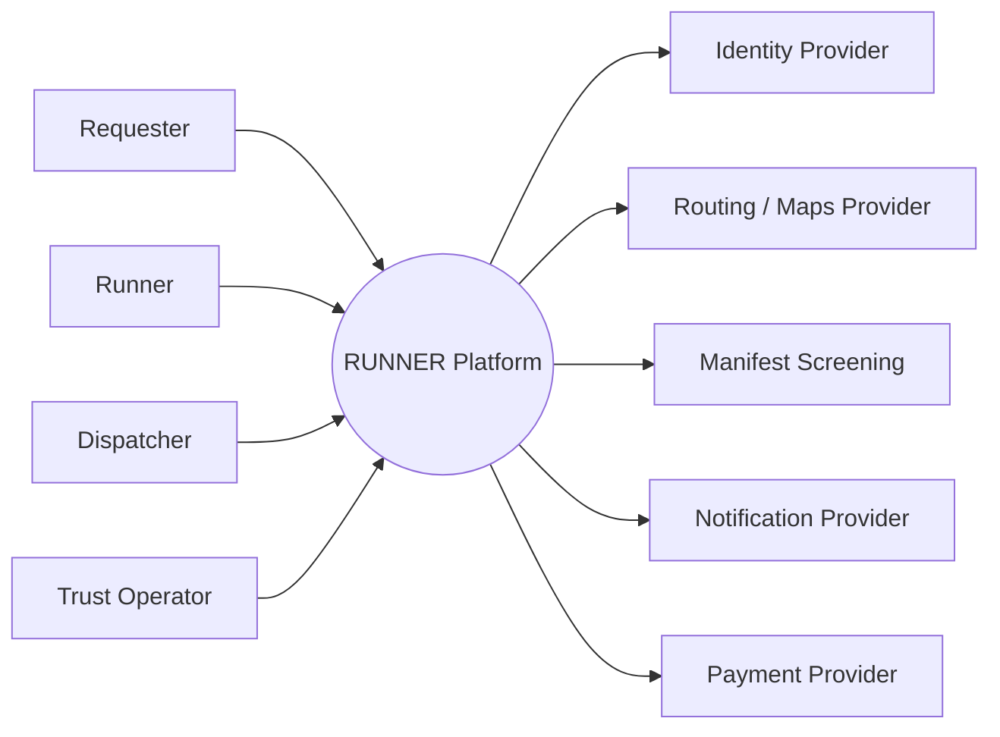
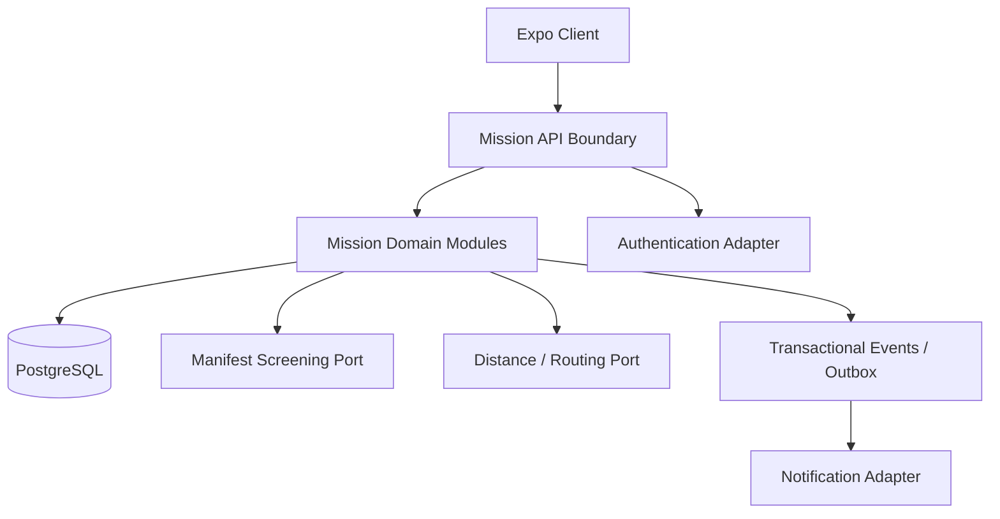

# RUNNER System Architecture

**Status:** Architecture baseline; production deployment and provider integrations pending  
**Reviewed:** 2026-11-26

## Product boundary

RUNNER is a mission network for moving permitted items between people and organizations. A mission has a requester, item declaration, pickup and destination, eligibility constraints, quote, custody events and verifiable completion. It is not a ride-hailing trip or food-order clone.

## C4 — System context

External providers shown are architectural dependencies, not currently configured integrations.

## C4 — Container view

The API is currently a framework-neutral Fetch handler. Provider adapters, deployment HTTP server, authentication implementation and live event workers remain to be built.

## C4 — Component boundaries

- Client: presentation, local interaction and authenticated API calls; never authoritative for pricing, eligibility, screening or custody.
- API: request parsing, authentication boundary, resource authorization, idempotency and error mapping.
- Mission domain: lifecycle, pricing contracts, policy, relay candidate planning and invariants.
- Persistence: PostgreSQL unit-of-work, mission projections, row locking, optimistic versions, events and idempotency receipts.
- Provider ports: identity, screening, routing, notifications and payments. Fail closed where safety or authorization depends on the provider.

## Core domain concepts

Account, RunnerProfile, VehicleProfile, Mission, MissionLeg, MissionAssignment, CustodyHandover, MissionEvent, MissionProof, PaymentIntent/LedgerEntry and SafetyCase.

## Mission lifecycle

draft → quoted → open → assigned → in progress → delivered → closed.

Exceptional states include cancelled, expired, failed, disputed and safety_hold. State changes are server-authoritative, validated, idempotent, timestamped and attributable. GPS alone never proves custody.

## Non-negotiable controls

1. Runner identity, capability, vehicle, jurisdiction and capacity are verified before assignment.
2. Custody uses explicit authenticated handoff evidence.
3. GPS is supporting evidence, not proof of possession or delivery.
4. Prohibited/regulated item policy gates fail closed.
5. Addresses and location traces are private and purpose-limited.
6. Money and mission transitions are idempotent and auditable.
7. Abuse controls, fraud review and emergency escalation are core platform functions.

## Deployment evolution

Start with a modular monolith and explicit domain boundaries. Extract services only when independent scaling, team ownership or fault isolation justify it. PostgreSQL is the transactional source of truth. Avoid premature microservices and infrastructure.

## Current implementation status

Implemented in repository: Expo client foundation; mission domain engine; pricing and relay candidate planner; PostgreSQL schema/repository adapter; initial Fetch-based mission API; automated domain/API tests.

Not implemented or deployed: production HTTP adapter, live identity provider, screening/routing integrations, dispatch workers, custody challenge issuance, payments, live location, realtime updates, cloud topology, observability deployment and native release builds.

See [ADR index](adr/README.md), [data model](DATA-MODEL.md), [security plan](SECURITY-PRIVACY.md) and [go-live checklist](GO-LIVE.md).
