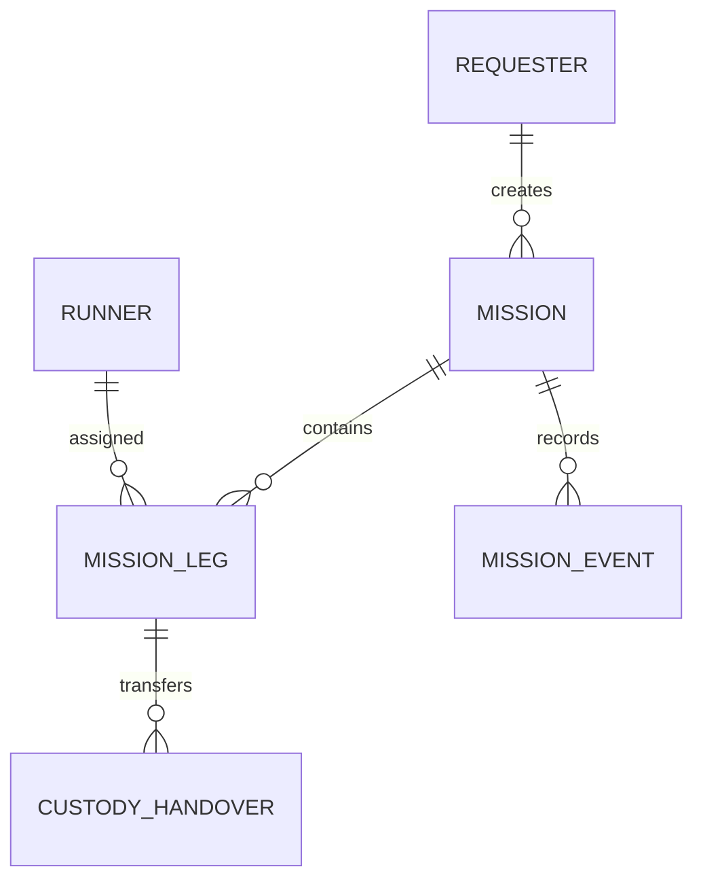

# Data Model & Persistence

Status: Schema baseline implemented; database not deployed or integration-tested.

## Entities

Missions; mission legs; Runner profiles; Runner capabilities and jurisdictions; custody handovers; append-only mission events; idempotency receipts.

## Integrity

Mission updates use transactions and expected versions. Events append with projection changes. Current migration blocks event mutation. Assignment must use row locks or CAS. Planned relay legs are not assignments; revalidate at assignment. Custody completes only after required two-party confirmation.

## Conceptual ERD

## Indexing

Migration defines initial indexes. Before production inspect query plans and optimize queue scans by status, zone, service window and creation time. Avoid indexes on sensitive address text.

## Deferred

No deployed PostGIS/H3, Redis, Kafka, search index or analytics warehouse.